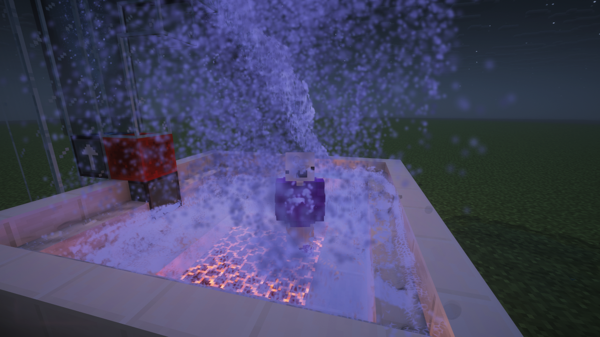
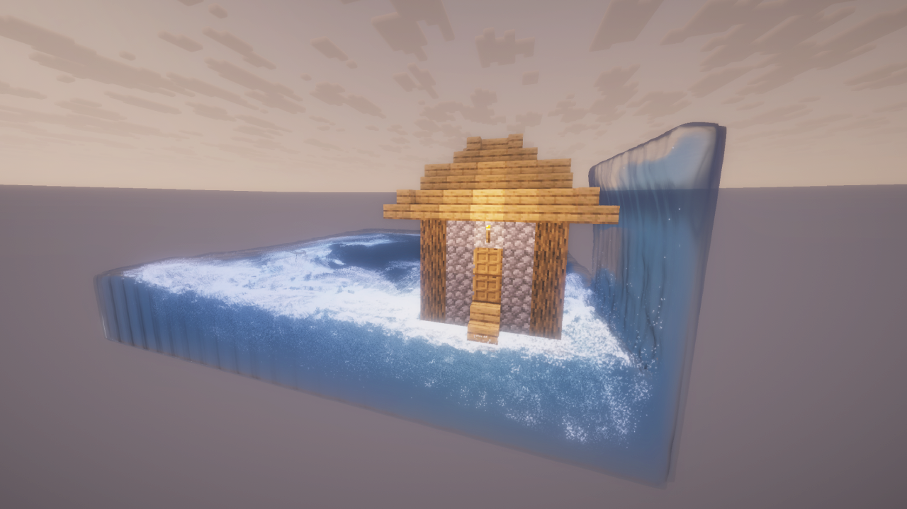
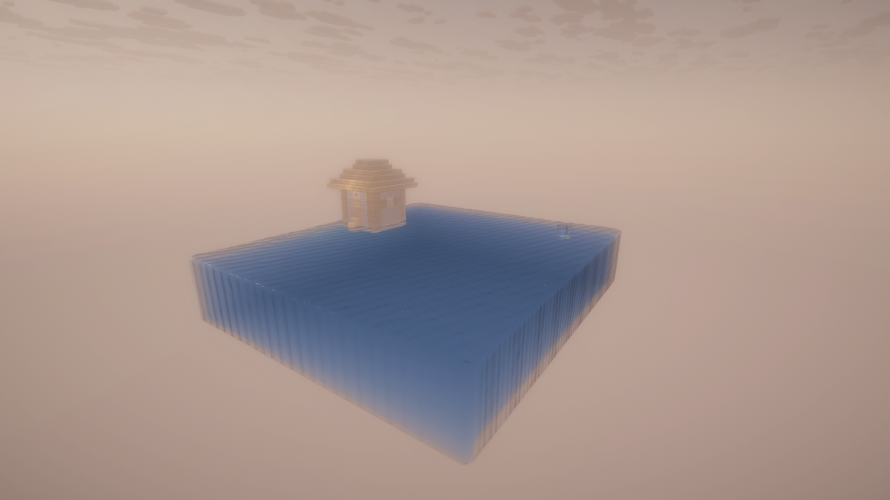
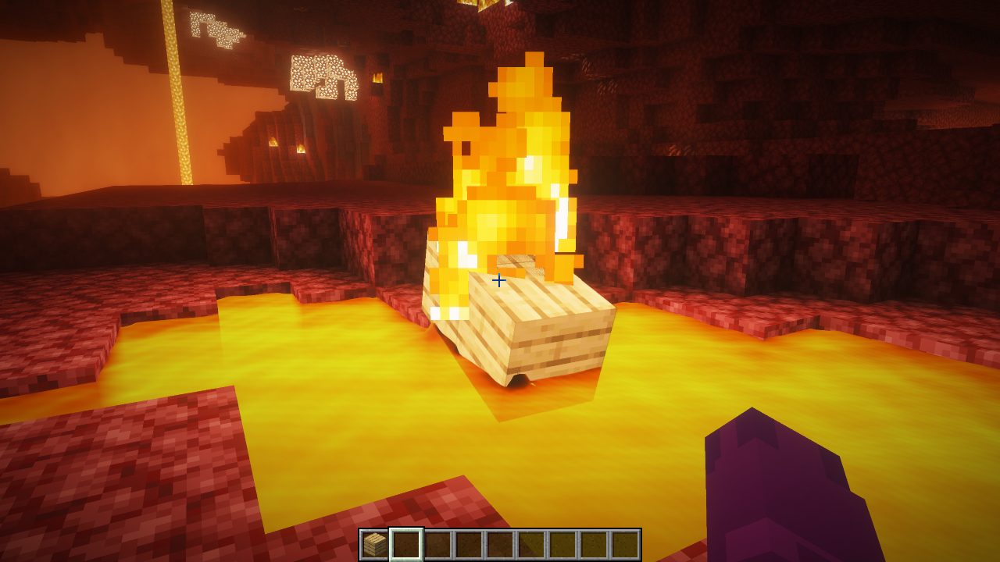
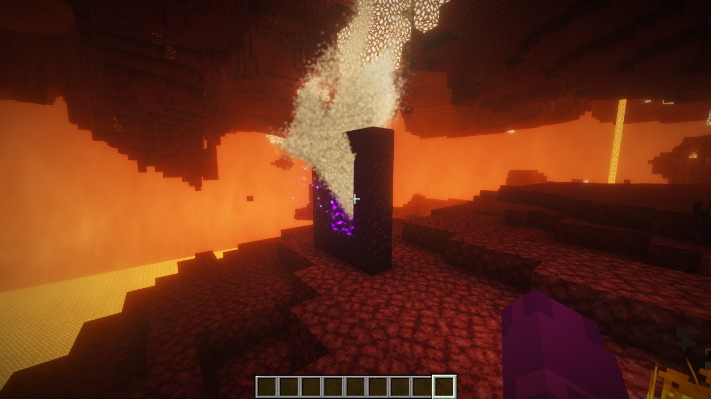
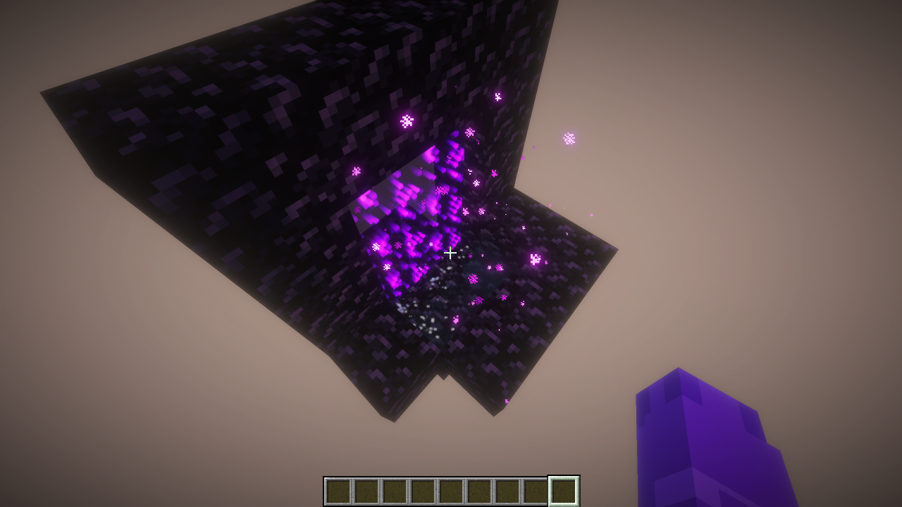

# Realistic Water
A Minecraft mod that adds a lot of cool, realistic stuff from Minecraft Blender animations.

#

How to use:

1. Download the latest version from: https://github.com/sskaffy/Realistic-Water/releases/
2. Install Fabric (Tutorial: https://docs.fabricmc.net/players/installing-fabric/)
3. Put the mod to the mods folder
4. Open the game and set the Graphics API in the Video Settings to Vulkan and then restart the game
5. Search up "Realistic" in the creative inventory to look at all the items from the mod
6. Use the "Realistic Convertor" to convert boats, redstone, or any full blocks into realistic blocks that have gravity
7. Remove them: use "/water remove" to remove water and "/water remove <block>" for everything else (op only) 
8. Use "Water Pump" to move water in ways it couldn't flow by itself (has to be powered by redstone)
9. Customize most things about how things look/move in "/water gui" (or just "/water" if you aren't op)
8. Use shaders with Vitrail! Any OF/Iris shaders (even Complementary Shaders) will work, download Vitrail from: https://modrinth.com/mod/vitrail-shaders

#

### Answers to questions:

Q: River/Ocean support?
A: Later

Q: OpenGL support?
A: Never

### What the mod contains:

- Realistic water
- Small Bucket of Realistic water (puts down only 1 block of realistic water instead of an infinite source)
- Realistic water boiling, moving with pumps, ultra realistic physics, reacting to entities, swim in it, react to realistic blocks
- Realistic blocks (can be obtained by right clicking a Realistic Convertor and putting any block inside)
- Realistic boat, works the best with realistic water, can be obtained via the Realistic Convertor
- Realistic lava, burns things, converts into cobble stone on realistic water contact, burns flameable realistic blocks, burns leaves
- Realistic sand
- Realistic leaves
- Realistic slime
- Realistic things react to TNT
- Realistic rain that the realistic water reacts to and the rain feeds the water (makes steam in lava)
- Sodium menu support
- Clip rendering and packing it into a mp4 with ffmpeg (the mod doesnt contain ffmpeg, you have to download it manually though you only need this if you wanna render clips inside the mod. you can just use obs)
- Water pumps, moves the water from its input to its output when powered by redstone (you can change the speed of it by right clicking on it)
- Water starts disappearing after being boiled for too long on too high temperature
- Water makes steam, boiling sounds, boiling particles on high temperature
- Water heats up by being too close to hot things like Magma Block, Campfire, Lava, Fire
- Too hot water damages you if you are inside
- Water cools down by having cold blocks around it like Ice, Snow Block, Snow or being in cold biomes. Putting more water in hot water will just make warm water which then cools down to the biome's temperature
- Realistic things like water, lava can go through any portals
- Vitrail shader loader support (Vitrail can load in any OF/Iris shader on Vulkan)

**Showcase:** https://www.youtube.com/watch?v=GG2-psEHUI4

#

**House made out of Realistic Blocks float on water:**

**Realistic Block burns in Realistic Lava:**

**Realistic Water turns into steam after entering the nether:**

Credits: https://github.com/claude and https://github.com/eva-akselrad
